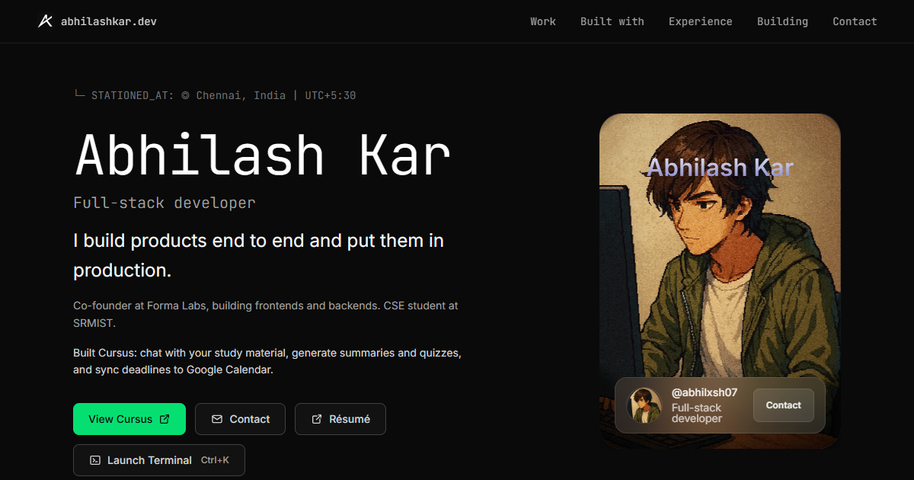

# abhilashkar.dev

Abhilash Kar's portfolio: shipped products, current experiments, and an interactive terminal. Built with React 19, Vite 7, Tailwind CSS 4, and Motion, with Vercel Analytics and Speed Insights.



## Run locally

Use a Node.js version supported by Vite 7 (20.19+ or 22.12+), and npm.

```sh
npm ci
npm run dev
```

Vite prints the local URL. To check and preview the production build:

```sh
npm run lint
npm run build
npm run preview
```

## Edit the content

`src/data/portfolio.js` contains the profile, navigation, projects, project-backed skill groups, experience, and contact links. Both the page and terminal use this content. Each project needs a stable ID; use `null` for unavailable links. Keep private source repositories unlinked.

`src/components/Projects.jsx` contains the Cursus case study and screenshot imports. `src/lib/terminalContent.js` formats the shared content for terminal commands. The other sections are individual components under `src/components/`.

Crawler-facing metadata lives in `index.html`. Keep its role, studio description, stack, and preview text consistent with the shared profile. The 1200×630 social preview is `public/og-preview.png`; `public/sitemap.xml` records the last published content date.

## Terminal

Click **Launch Terminal**, or press **Ctrl+K** on Windows/Linux and **⌘K** on macOS. Type `/` for the searchable command list, use the arrow keys for command history, and press Escape to close.

Commands include `about`, `skills`, `projects`, `experience`, `contact`, `cat resume.txt`, `neofetch`, `coffee`, and `doom`. Doom runs in a sandboxed external iframe on desktop. The terminal restores focus to its trigger. Motion settings follow the visitor's reduced-motion preference.

## Deployment and integrations

Vercel builds with `npm run build` and serves `dist/`. `vercel.json` configures response headers and the `/resume` redirect. Vite's local preview does not apply those Vercel settings; verify them on a Vercel preview deployment.

The résumé currently redirects to Google Drive and needs an owner-supplied update. A legacy `public/resume.pdf` is retained until the canonical résumé is confirmed.

The contact form posts to Web3Forms using its public client access key, including the `botcheck` honeypot. Browser validation of the form should intercept requests and mock both success and failure responses; do not send test messages to the live inbox.

Security headers include HSTS, nosniff, frame denial, a referrer policy, and a permissions policy. The Content Security Policy is currently **report-only**. Exercise the form, fonts, analytics, terminal, and Doom on a preview deployment before enforcing it.

Discord verification is served from `public/.well-known/discord`.

## Dependency audit

On 19 October 2026, `npm audit --omit=dev` reported **zero production-dependency advisories** after compatible updates to `nanoid`, `postcss`, and `source-map-js`. This is a dated dependency check, not a security guarantee for the application. The earlier “8 → 0” claim needs its original audit report before it can be documented as a historical result.

## Contributing

Work on a feature branch, run lint and the production build, inspect phone/tablet/desktop layouts, and open a pull request for a Vercel preview. Verify section links, terminal commands, keyboard focus, reduced motion, and mocked contact-form responses when changing those features. Do not commit local caches or generated builds.
